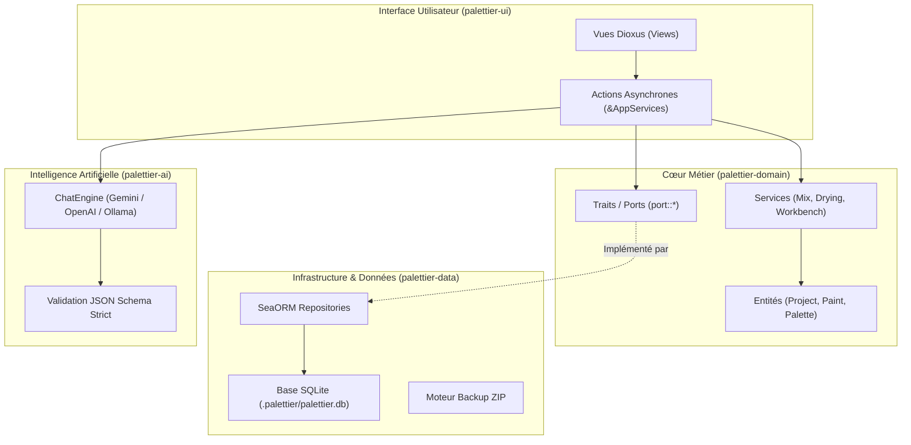

# Architecture et Documentation Technique de Palettier

Palettier est une application d'atelier pour peintres de figurines, modélistes et sculpteurs, développée en **Rust 2024** avec un paradigme d'architecture hexagonale (Ports & Adapters) et sans compromis sur la sécurité mémoire (`#![forbid(unsafe_code)]`).

---

## 1. Vue d'ensemble du Workspace Cargo

Le projet est structuré en plusieurs crates indépendantes avec des frontières de responsabilité strictes :

```
palettier/
├── crates/
│   ├── palettier-domain/   # Cœur métier pur, modèles optiques et physiques, ports d'abstraction
│   ├── palettier-image/    # Décodage sécurisé, échantillonnage en lumière linéaire, Notan
│   ├── palettier-data/     # Persistance SQLite via SeaORM, migrations, backup ZIP, seeders
│   ├── palettier-ai/       # Intégrations IA multimodale (Gemini, OpenAI, Ollama), schémas stricts
│   ├── palettier-ui/       # Interface desktop réactive Dioxus 0.6 Desktop
│   └── palettier-cli/      # Outil CLI pour maintenance, sauvegardes, synchro catalogue
├── Cargo.toml              # Configuration du workspace et lints globaux
└── clippy.toml             # Configuration stricte de Clippy
```

---

## 2. Principes d'Architecture & Bonnes Pratiques Rust

### 2.1 Pureté du Domaine (`palettier-domain`)
- **Indépendance totale** : `palettier-domain` ne dépend ni de SeaORM, ni de Dioxus, ni d'aucun moteur de base de données.
- **Modélisation physique et colorimétrique** :
  - **Kubelka-Munk** : Modélisation soustractive des pigments selon leurs coefficients d'absorption $K$ et de diffusion $S$.
  - **CIEDE2000** : Calcul perceptuel de distance de couleur ($\Delta E_{00}$) via conversion sRGB $\to$ linéaire $\to$ CIELAB.
  - **Physique du séchage** : Simulation de l'oxydation (huile, gouvernée par la nature des pigments) et de l'évaporation (acrylique, gouvernée par l'épaisseur, l'humidité et la ventilation de l'atelier).
  - **Invariants physiques (Gras sur Maigre)** : Détection automatique des couches risquées (couche maigre sur couche grasse ou acrylique sur huile non polymérisée).
- **Ports & Inversion de dépendance** : Le module `palettier_domain::port` définit les traits asynchrones (`PaintCatalogRepository`, `ProjectRepository`, etc.) implémentés par `palettier-data`.

### 2.2 Sécurité et Invariants Système
- **`#![forbid(unsafe_code)]`** : Imposé sur tout le workspace via `[workspace.lints.rust]`.
- **Défense en profondeur contre les dénis de service d'image (Zip Bombs / Image Bombs)** :
  - `MAX_IMAGE_DIMENSION = 8192` px et `MAX_ALLOC_BYTES = 256 Mo` dans `palettier-image::ImageDecoder`.
- **Défense contre le Path Traversal dans les sauvegardes** :
  - `palettier-data::backup` valide et assainit chaque nom de fichier d'archive ZIP pour empêcher les attaques de traversée de répertoire.
- **Sécurisation des secrets IA** :
  - Les clés d'API sont protégées via `secrecy::SecretString` et nettoyées en mémoire avec `zeroize`.

### 2.3 Concurrence & Asynchronisme
- **Tokio** pour la gestion des E/S réseau (appels IA) et de la persistance SQLite.
- **Rayon** pour le calcul parallèle intensif des combinaisons de mélanges de tubes dans le catalogue.
- **Transactions atomiques** : Les mises à jour par lot (stock, étapes de recettes) s'exécutent dans des transactions isolées.

### 2.4 Ergonomie des Types (Type-Driven Development)
- Utilisation de `newtype` et d'enums exhaustifs avec des représentations fortes (`Technique`, `PaintSystem`, `DryingClass`, `Opacity`, `Finish`, `Ventilation`).
- Sérialisation et désérialisation robustes via `serde`.
- Gestion d'erreurs typées avec `thiserror::Error` pour `DomainError`.

---

## 3. Flux de Données & Orchestration



---

## 4. Documentation du Code & Rustdoc

Toutes les crates supportent la génération complète de documentation HTML avec doc-tests exécutables :

```bash
# Génération de la documentation locale
cargo doc --workspace --no-deps --open

# Exécution des tests unitaires et des doc-tests
cargo test --workspace
```
